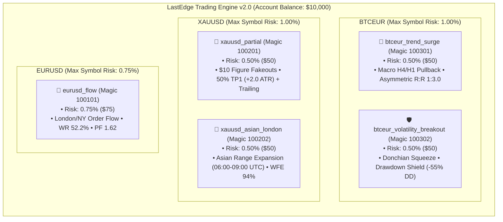

# LastEdge 10k Autonomous Challenge — Portfolio Architecture 🛡️🚀

> **Event:** 60-Day $10,000 Autonomous Trading Challenge  
> **Start Date:** Monday, November 16, 2026  
> **Trading Terminal:** MetaTrader 5 (Raw/ECN Retail Hedging)  
> **Risk Engine:** LastEdge Risk Engine v2.0 (Zero Discretion)  
> **Verification:** Real-time Myfxbook Public Tracking  

---

## 1. Executive Summary & Philosophy

Retail traders overwhelmingly fail due to emotional bias: moving stop losses mid-trade, overleveraging during drawdowns, and revenge trading. 

The **LastEdge 60-Day 10k Autonomous Challenge** is a live institutional demonstration of algorithmic discipline. The engine manages a **$10,000 capital base** across **5 complementary strategies distributed over 3 non-correlated asset classes** (`EURUSD`, `XAUUSD`, `BTCEUR`).

Every execution, partial close, break-even lock, trailing ratchet, and risk guard is enforced programmatically with zero human intervention.

---

## 2. The 5-Strategy Portfolio Matrix



---

## 3. Allocation & Technical Specifications

| Asset | Strategy | Magic Number | Base Risk / Trade | Max Symbol Risk | Operational Regime & Hours | Exit Protocol |
| :--- | :--- | :---: | :---: | :---: | :--- | :--- |
| **EURUSD** | `eurusd_flow` | `100101` | **0.75%** ($75) | **0.75%** | London (07-11 UTC) & NY (13-17 UTC) Order Flow | 1:2.0 Target + BE at +1.0 ATR |
| **XAUUSD** | `xauusd_partial` | `100201` | **0.50%** ($50) | **1.00%** | London/NY Fakeouts & Psychological Figure Rejection | 50% TP1 (+2.0 ATR) + Trailing 1.5 ATR |
| **XAUUSD** | `xauusd_asian_london` | `100202` | **0.50%** ($50) | **1.00%** | Asian/London Transition Breakout (06:00-09:00 UTC) | 1:1.8 Target + Dynamic Asian Boundary SL |
| **BTCEUR** | `btceur_trend_surge` | `100301` | **0.50%** ($50) | **1.00%** | H4 Macro Trend + H1 EMA20 Pullback (Continuous 24/7) | 1:3.0 Target (SL 1.5 ATR / TP 4.5 ATR) |
| **BTCEUR** | `btceur_volatility_breakout` | `100302` | **0.50%** ($50) | **1.00%** | Donchian 20 Volatility Squeeze Expansion (24/7) | 1:2.6 Target (SL 1.6 ATR / TP 4.2 ATR) |

---

## 4. Multi-Strategy Retail Hedging Mechanics

In MetaTrader 5, standard retail netting accounts collapse opposing positions into a single aggregate ticket. LastEdge requires **Retail Hedging** (`ACCOUNT_MARGIN_MODE_RETAIL_HEDGING = 2`):

1. **Independent Lifecycle Tracking:** Each model manages its own position via its unique `magic_number`. If `xauusd_asian_london` is trailing a long runner, a new short fakeout setup from `xauusd_partial` will open as an independent ticket without interfering with the existing trail.
2. **Split-Risk Guarantee:**
   $$\text{Total Symbol Risk} = \text{Risk}(\text{Strategy}_A) + \text{Risk}(\text{Strategy}_B) \le 1.00\%$$
   The portfolio guarantees that even if both strategies on the same symbol trigger simultaneously, the combined initial risk is strictly capped at \$100 (1.00% of the $10k account).
3. **Margin Protection:** Total simultaneous portfolio margin allocation is capped at 2.75% of account equity.

---

## 5. Risk Engine v2 — Non-Negotiable Hard Guardrails

All executions are governed by the autonomous risk engine with the following hard ceilings:

```text
[Signal Triggered] ──► [Spread Guard (Max 3.0 pips)]
                              │ (Passed)
                              ▼
                     [News Blackout Filter (±30 min High-Impact)]
                              │ (Passed)
                              ▼
                     [Daily Drawdown Guard (< 3.0% / $300)]
                              │ (Passed)
                              ▼
                     [Total Portfolio Kill-Switch (< 5.0% / $500)]
                              │ (Passed)
                              ▼
                     [Monotonic Position Sizing (0.50% or 0.75% Risk)]
                              │
                              ▼
                     [MT5 Market Order Execution + SQLite WAL Hydration]
```

- **Daily Loss Cap (3.0% / $300):** If aggregate realized + unrealized loss reaches 3.0% in a single trading day, new signal entries are blocked until the next market session.
- **Total Portfolio Kill-Switch (5.0% / $500):** If total account drawdown hits 5.0% from high-water mark, the engine immediately flattens all open market positions via unconstrained DEAL liquidation and locks its state to `PARKED`. Manual database clearance is required to resume.
- **Circuit Breaker:** 3 consecutive losses on an individual strategy pauses that specific strategy for 12 hours while leaving non-correlated strategies active.
- **Weekend Exposure Guard:** Every Friday at **21:30 UTC**, the engine auto-flattens all open `EURUSD` and `XAUUSD` positions and rejects new orders until Sunday open (22:00 UTC). `BTCEUR` is excluded and continues trading 24/7.
- **Monotonic Ratchet Principle:** Stop losses can only tighten (locking profit or reducing risk), never widen. Any manual or disconnection drift is audited and clamped forward immediately.

---

## 6. Public Verification & Transparency

- **Myfxbook Link:** The verified public tracking URL will be published on **November 16, 2026** at the official start of the challenge.
- **Execution Audits:** Every trade lifecycle (open, breakeven lock, partial close, trailing ratchet, final exit) is logged to the SQLite WAL database and broadcast to the LastEdge Mobile App and private audit feeds.
